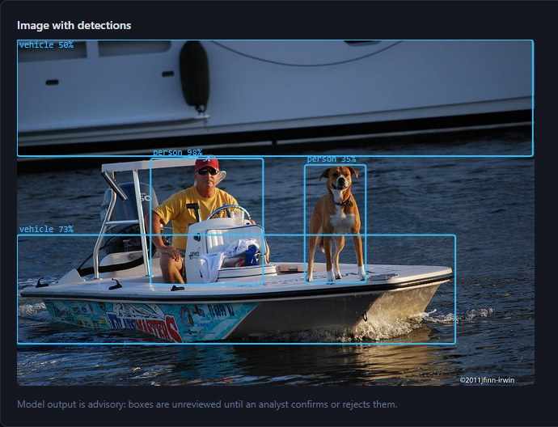
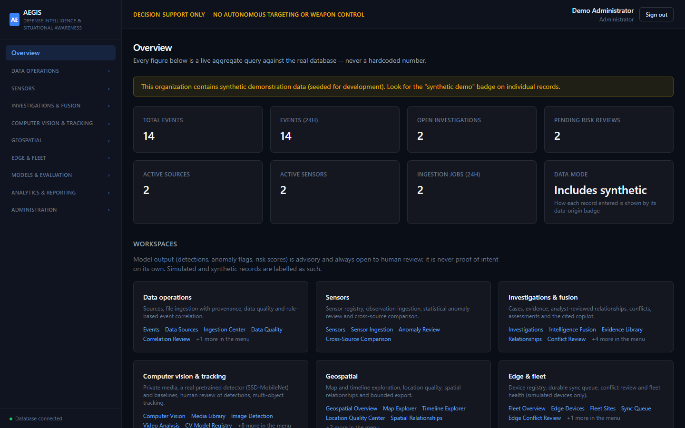
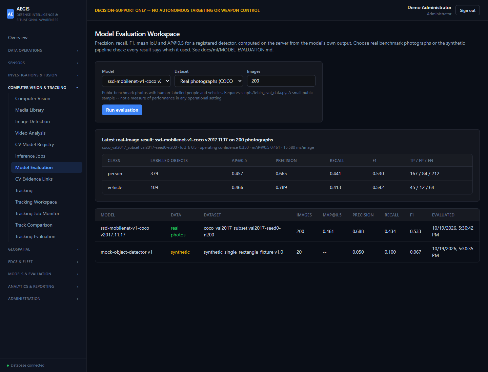
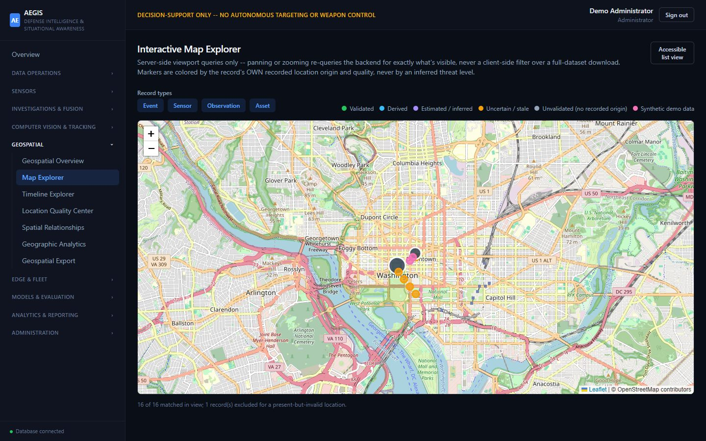
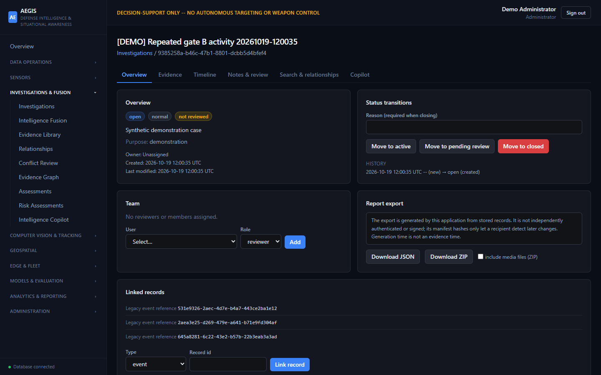
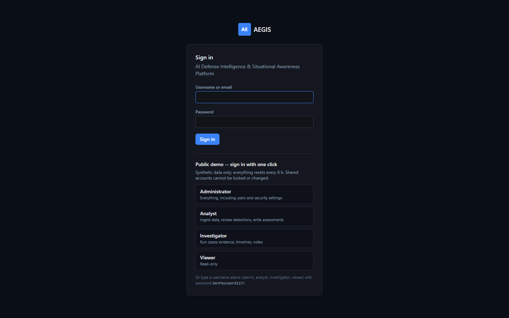
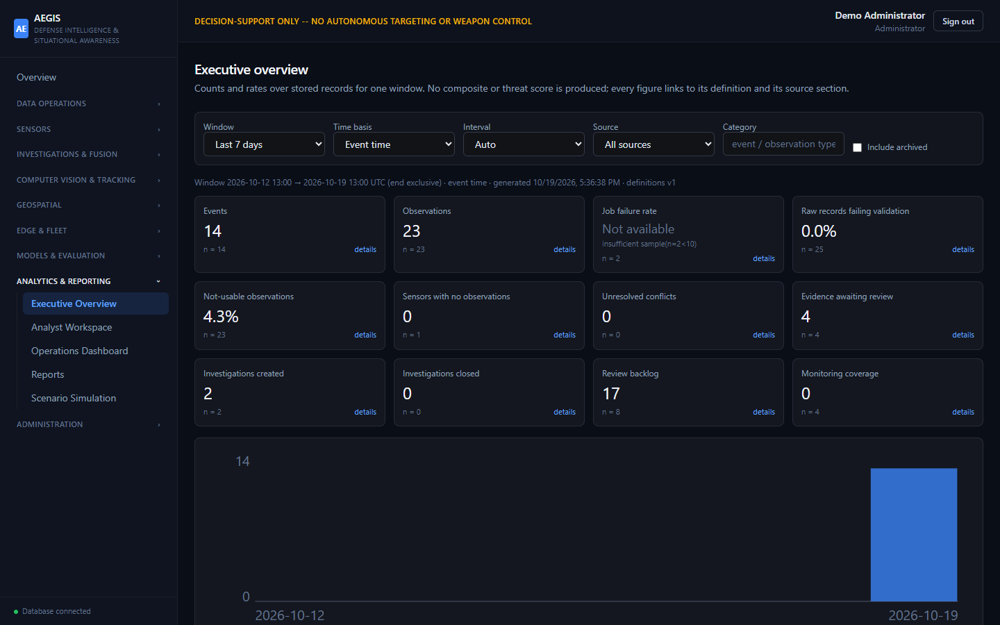
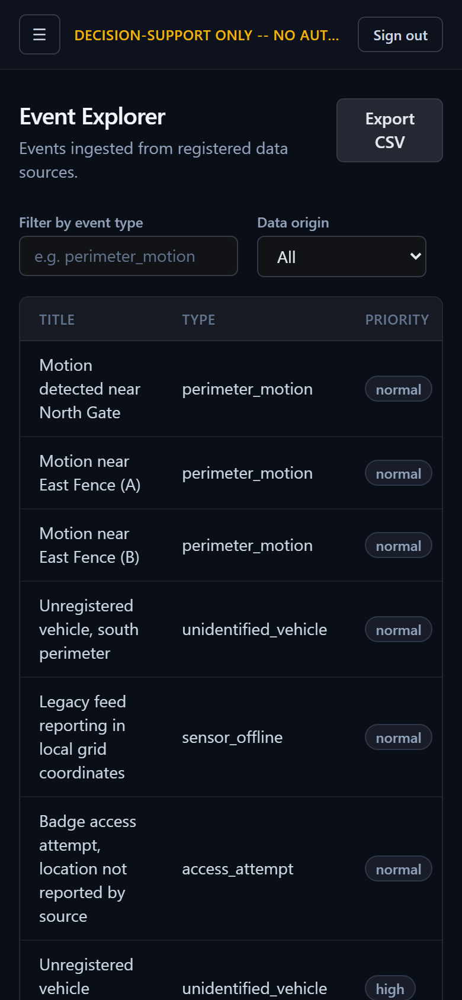
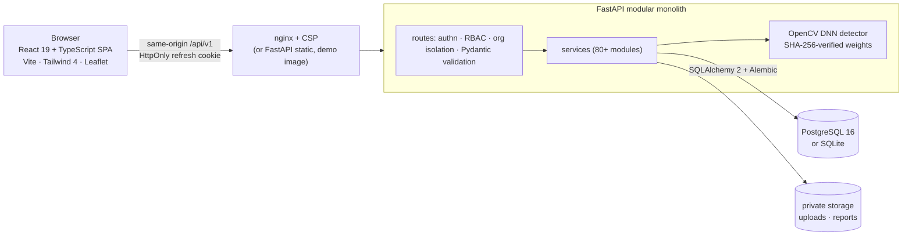

<div align="center">

# AEGIS

**A full-stack analyst platform for defense-style intelligence work: ingest multi-source data, run and
review a real object detector, build investigations from evidence, and report on it.**

[](LICENSE)


**[▶ Live demo](https://aegis-demo-blr2.onrender.com)** (*Explore the live demo* starts a guest session; synthetic data; free tier, so allow about a minute for the first load) ·
[Features](#features) · [Run it in one command](#run-it-in-one-command) · [Real detection](#real-object-detection) ·
[Architecture](#architecture) · [Engineering](#engineering-highlights) · [Free hosting](#host-a-free-public-demo) · [Docs](#documentation)

 

</div>

> **What this is -- and is not.** AEGIS is a **software engineering and research demonstration** of
> human-supervised decision support. It contains **no** targeting, weapon-control, engagement or
> automated-action capability. Model output is advisory and reviewed by a person; demo data is
> **synthetic**; edge devices are **simulated**; detection quality is measured only on public photos.

## Features

| Area | What you can do |
|---|---|
| **Computer vision** | Run a **pretrained SSD-MobileNet detector** (person, vehicle) on uploaded images and video; review each detection before it can become evidence; track objects across frames |
| **Model evaluation & MLOps** | Score detectors on **200 real COCO photographs** (AP@0.5, precision/recall/F1 per class); model registry with governance, experiments, drift monitoring and review queues |
| **Investigations & fusion** | Evidence registry with integrity hashes, analyst-reviewed relationships, conflict review, versioned assessments, case timelines and notes, reproducible exports |
| **Data operations** | JSON/CSV ingestion with validation, de-duplication and raw-record provenance; data quality and correlation; an SSRF-hardened HTTP connector |
| **Geospatial** | Leaflet map with server-side viewport queries, timeline, location quality, spatial relationships, GeoJSON/CSV export |
| **Analytics & reporting** | 93 catalogued metrics; executive, analyst and operations dashboards; JSON/CSV/HTML reports with integrity hashes |
| **Access control** | Four roles (administrator, analyst, investigator, viewer) and per-organization isolation enforced server-side; audit log; data-lifecycle approvals |
| **Copilot** | Keyword (BM25) retrieval, re-authorized on every query, with extractive cited answers |

**Simulated by design:** sensors and edge/fleet devices, what-if scenarios (labelled SIMULATED), and a
deterministic mock detector kept for pipeline tests. **Not built:** background job queue, MFA/SSO, GPU
inference, high availability ([roadmap](docs/implementation/MASTER_ROADMAP.md)).

| Model evaluation on real photos | Interactive map | Investigation workspace |
|---|---|---|
|  |  |  |
| **Sign-in with guest access** | **Executive dashboard** | **Phone layout** |
|  |  |  |

*Screenshots of the actual application running as the public demo, with synthetic data. The detection
photo is COCO val2017 #190140 (Flickr, CC BY 2.0, © 2011 jfinn-irwin); note the honest mistake -- the
dog is labelled "person" at 35 %.*

## Run it in one command

With Docker installed:

```bash
docker build -t aegis-demo .
docker run --rm -p 7860:7860 aegis-demo
```

Open <http://localhost:7860> and pick a role on the sign-in page. The container builds the frontend,
downloads and verifies the detector weights and the COCO sample, then on start creates a fresh database,
loads synthetic demo data, runs the real detector on three photos and evaluates it -- about a minute.

For development, run the backend and frontend directly ([Local development](#local-development)).

## Real object detection

The real detector is **SSD with a MobileNet v1 backbone, trained on COCO** (TensorFlow model zoo,
Apache-2.0), run on CPU through OpenCV's DNN module -- no PyTorch or GPU. `scripts/fetch_models.py`
downloads it from the official source and verifies every file against a pinned SHA-256; a missing or
modified file is refused.

Measured on **200 COCO val2017 photographs** (379 people, 109 vehicles, 92 images with neither) through
the same post-processing the application uses:

| Detector | mAP@0.5 | Person AP / precision / recall | Vehicle AP / precision / recall | ms/image (CPU) |
|---|---|---|---|---|
| **SSD-MobileNet v1 COCO** | **0.461** | 0.457 / 0.665 / 0.441 | 0.466 / 0.789 / 0.413 | 15 |
| OpenCV HOG person (classical baseline) | 0.003 | 0.005 / 0.155 / 0.024 | -- | 31 |
| Mock (pipeline testing, not a model) | 0.000 | -- | -- | <1 |

A light 2017 mobile detector on everyday photos; these numbers say nothing about aerial, thermal or
operational imagery. Method and limits: [`docs/ml/MODEL_EVALUATION.md`](docs/ml/MODEL_EVALUATION.md).

## Architecture



Each request is authenticated (JWT), authorized by role and organization, validated, handled by a
service in `backend/app/services/` and persisted through SQLAlchemy; every timestamp is stored and
returned as UTC. Ingestion, inference, tracking, evaluation and reports run inside the request with size
and time limits. More: [architecture decisions](docs/architecture/ARCHITECTURE_DECISIONS.md),
[module catalog](docs/architecture/MODULE_CATALOG.md).

**Stack:** Python · FastAPI · SQLAlchemy 2 · Alembic · Pydantic 2 · PyJWT · bcrypt · slowapi ·
NumPy/SciPy · OpenCV · pytest -- TypeScript · React 19 · React Router 7 · Vite 6 · Tailwind CSS 4 ·
Leaflet · Vitest · Testing Library -- PostgreSQL 16 / SQLite · nginx · Docker · GitHub Actions.

## Engineering highlights

- **Tested on both databases:** 1,426 backend tests on SQLite, and the full suite on PostgreSQL 16
  with a non-UTC server time zone (which caught a real bug); 59 frontend tests; every one of 76 routes opened in
  a real browser for each role and at phone width, under the production Content-Security-Policy.
- **Security by construction:** authorization and tenant isolation checked on every operation by a test
  that sweeps the whole API; access token in memory, refresh token in an HttpOnly SameSite=Strict
  cookie; `script-src 'self'` CSP; production start-up refuses weak secrets; errors never echo input;
  `pip-audit`, `npm audit`, `bandit` and `detect-secrets` clean.
- **Supply-chain integrity for ML:** model weights and evaluation data pinned by SHA-256; a tampered
  file is refused at load time.
- **Honest evaluation:** real-photo AP next to a synthetic pipeline check, each result labelled with
  its dataset; undefined metrics are shown as undefined, never as 0.
- **Operations:** Alembic migrations with drift checks, backup and restore with read-back verification,
  structured JSON logs with redaction, readiness checks, runbooks, a repeatable release check
  (`scripts/verify_release.py`).

## Host a free public demo

The root [`Dockerfile`](Dockerfile) packages frontend and backend into one container that runs free on
a **Render** free web service. In demo mode, visitors choose *Explore the live demo*, which opens a guest session as
the analyst (ingest data, run the detector, write assessments; no user or security administration) without any
password. Before the site is announced ready, every seeded account gets a random password nobody knows, so the
development password in this repository can't be used against it; the owner's administrator comes from hosting
secrets (`AEGIS_ADMIN_USERNAME`, `AEGIS_ADMIN_PASSWORD`). All data resets every 6 hours. Step-by-step: [`docs/operations/PUBLIC_DEMO.md`](docs/operations/PUBLIC_DEMO.md).

For a real deployment (PostgreSQL, nginx, persistent volumes, TLS) see
[`DEPLOYMENT_GUIDE.md`](docs/operations/DEPLOYMENT_GUIDE.md) and `docker-compose.yml`.

## Local development

Requirements: **Python 3.12+**, **Node.js 20+**. No accounts or API keys needed.

```bash
# backend
cd backend
python -m venv .venv && source .venv/bin/activate      # Windows: .venv\Scripts\Activate.ps1
pip install -r requirements.txt
cp .env.example .env                                     # Windows: Copy-Item .env.example .env
alembic upgrade head
python scripts/seed.py                                   # development accounts + synthetic data
python scripts/fetch_models.py                           # optional: real detector (~29 MB)
python scripts/fetch_eval_data.py                        # optional: 200 COCO photos (~33 MB)
uvicorn app.main:app --reload --port 8000

# frontend (second terminal)
cd frontend
npm ci
npm run dev                                              # http://localhost:5173
```

Sign in as `admin`, `analyst`, `investigator` or `viewer` with password `DevPassword123!`
(local development accounts created by `seed.py`; the public demo replaces these passwords with random ones). Load a full demo data set with
`python scripts/demo_walkthrough.py`. Details and troubleshooting:
[`docs/guides/LOCAL_DEVELOPMENT.md`](docs/guides/LOCAL_DEVELOPMENT.md).

**Checks:** `python scripts/verify_release.py` runs everything locally (tests, migrations, lint, build,
audits, secret scan) and reports PASS / FAIL / NOT RUN per check. Individually: `pytest -q` in
`backend/`; `npm run lint`, `npm test`, `npm run build` in `frontend/`.

## Documentation

| | |
|---|---|
| Status and verification | [Project status](docs/implementation/PROJECT_STATUS.md) · [Release verification](docs/operations/RELEASE_VERIFICATION.md) · [Changelog](CHANGELOG.md) |
| Running it | [Public demo](docs/operations/PUBLIC_DEMO.md) · [Deployment](docs/operations/DEPLOYMENT_GUIDE.md) · [Configuration reference](docs/operations/CONFIGURATION_REFERENCE.md) · [Backup & restore](docs/operations/BACKUP_AND_RESTORE.md) · [Runbooks](docs/operations/RUNBOOKS.md) |
| Design | [Architecture decisions](docs/architecture/ARCHITECTURE_DECISIONS.md) · [Module catalog](docs/architecture/MODULE_CATALOG.md) · [API](docs/api/) |
| ML | [Model adapters](docs/ml/MODEL_ADAPTERS.md) · [Model evaluation](docs/ml/MODEL_EVALUATION.md) |
| Security | [Security policy](SECURITY.md) · [Known risks](docs/security/KNOWN_RISKS.md) |

**Known limitations:** one light CPU detector, not validated on operational imagery; sensors and edge
devices simulated; synchronous jobs (no queue); one backend process per database; the CI workflow and
Docker images are authored but have not yet run on GitHub.

## License

[MIT](LICENSE) © 2026 balak. Third-party parts keep their own licences: detector weights Apache-2.0
(TensorFlow model zoo); COCO annotations CC BY 4.0 and each photo its own Creative Commons or
public-domain licence, recorded per image (the demo image bundles the 200-photo sample with that
manifest); Leaflet BSD-2-Clause; map tiles © OpenStreetMap contributors; `psycopg2-binary` LGPL (used
unmodified). Details: [`docs/operations/LICENSE_DECISION.md`](docs/operations/LICENSE_DECISION.md).

Contributions welcome -- see [`CONTRIBUTING.md`](CONTRIBUTING.md).
